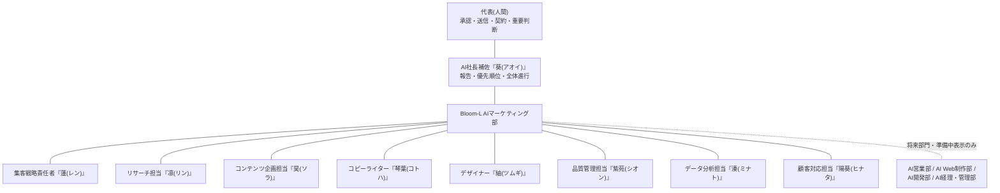

# 04. AI組織設計

## 1. 組織図【確定(§9)+名前候補は推奨】

名前候補は花・植物にちなむ和名で統一【推奨: ブランド名 Bloom(咲く)との一貫性。設定ファイルで変更可能にする】。

## 2. 表示キャラクターと実行プロセスの分離【確定(§9)】

| 層 | 実体 | 数 |
|---|---|---|
| 表示層 | ピクセルアートのAI社員キャラクター | 9名(常時表示) |
| 実行層 | Claude Codeセッション内のサブエージェント呼び出し | 同時1〜2、必要時のみ順次起動 |
| 共有層 | SQLiteのタスク・成果物・イベント + 当日のコンテキストファイル | 全社員が同一情報を参照(重複調査の禁止) |

- 「9名が常に働いている」ように**見せない**。実行していない社員は「待機」表示(§13信頼性条件)
- 同一情報の共有: 当日の調査結果・会議決定は `runs/{date}/context.md` に集約し、後続エージェントの入力に含める(同じ調査を二度しない)

## 3. 会議体【推奨】

| 会議 | 頻度 | 参加(実行層) | 成果物 |
|---|---|---|---|
| 日次スタンドアップ | 毎営業日(始業コマンド内) | 社長補佐のみ(他社員の状態はDBから読む) | 本日の優先順位・起動する担当リスト |
| 週次AI集客会議 | 週1(月曜の始業時) | 社長補佐+戦略+企画+分析 | 議事録(minutes)・翌週テーマ案・カレンダー更新・改善決定 |
| 月次レビュー | 30日ごと | 社長補佐+戦略+分析 | 月報・KPI再設定提案(根拠付き) |

- 会議は「複数エージェントの同時対話」ではなく、**順次呼び出し+共有コンテキスト**で実現(コスト・再現性・§9の並列禁止に適合)
- 議事録は必ず保存し、UIの会議室/議事録画面から閲覧可能(§13)

## 4. 権限マトリクス【確定ルールの整理】

| 行為 | AI社員 | AI社長補佐 | 代表者 |
|---|---|---|---|
| 調査・下書き・画像案生成 | ○ | ○(指示) | — |
| 品質判定(QA合格/差し戻し) | ○(品質管理のみ) | — | — |
| 投稿の公開承認 | ✕ | ✕ | **○(唯一)** |
| Instagramへの投稿・DM送信 | ✕(自動送信禁止) | ✕ | **○(手動)** |
| 価格・納期・契約条件の確定 | ✕ | ✕ | **○** |
| 顧客名・顧客素材の公開判定 | ✕(許可記録の確認のみ) | ✕ | **○** |
| モデル昇格(上位モデル利用) | ✕ | ○(ルール内で提案) | ○(ルール変更) |
| 予算しきい値の変更 | ✕ | ✕ | **○** |
| タスク停止・再開・キャンセル | ✕ | ○ | ○ |

## 5. 将来部門(準備中)【確定(§13)】

| 部門 | 表示する将来の役割 | 解放条件(表示用・提案) |
|---|---|---|
| AI営業部 | 見込み客リスト整理・提案書下書き | マーケ部が安定運用60日+DM相談月5件 |
| AI Web制作部 | 制作進行管理・素材収集支援 | 受注が月2件を超え制作管理が逼迫したとき |
| AI開発部 | SaaS・業務システムの要件整理支援 | 上位提案の商談が発生したとき |
| AI経理・管理部 | 請求・入金管理の下書き | 取引件数が手作業限界を超えたとき |

- クリック時は役割と解放条件のみ表示。**稼働状態・タスク・進捗は一切表示しない**(実装済みに見せない)
