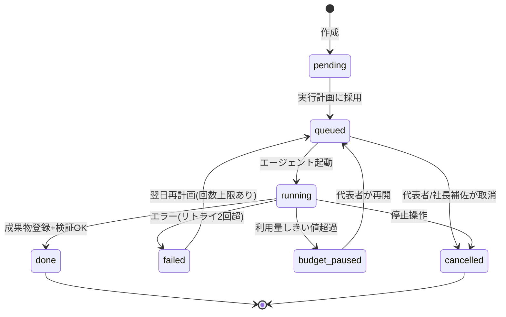
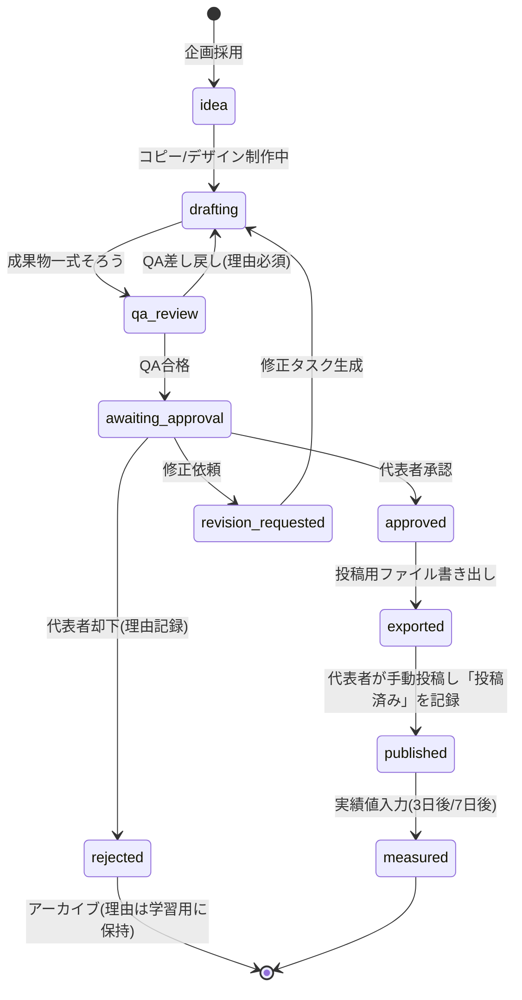
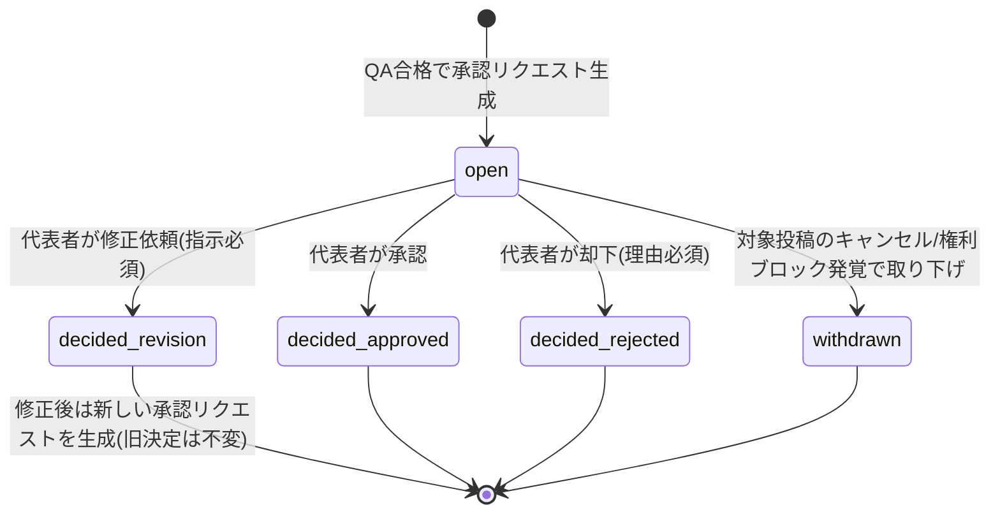
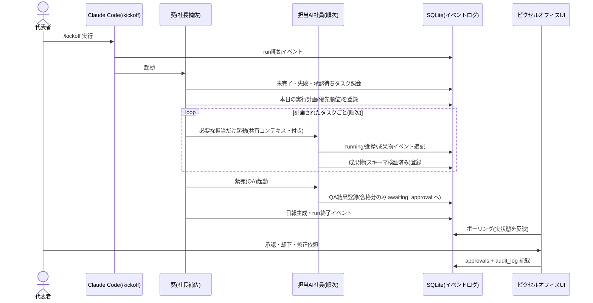
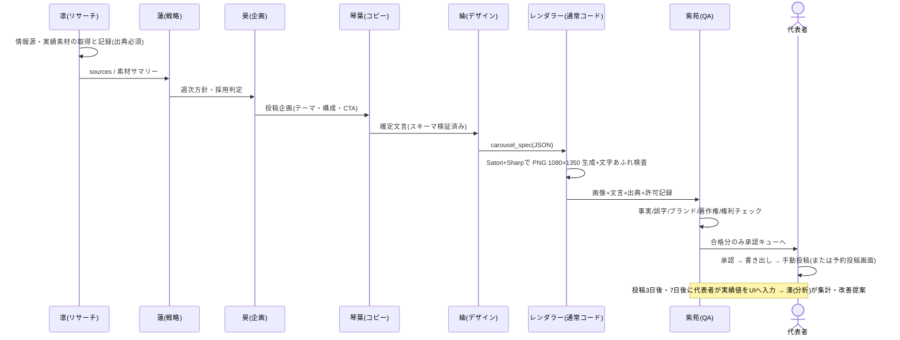
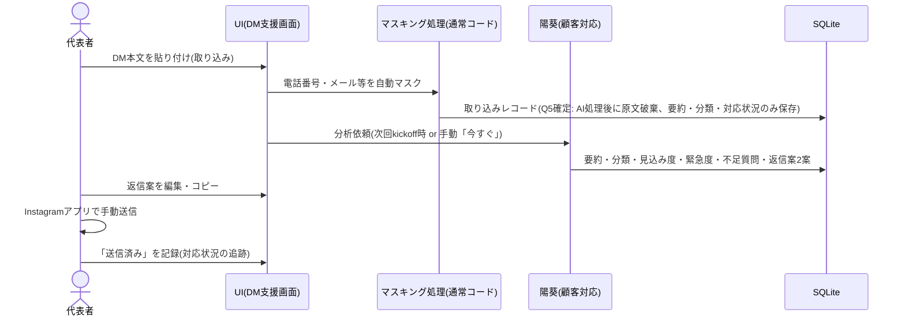

# 06. ワークフローと状態遷移

## 1. 状態モデルの原則【確定§19】

- タスク(作業単位)・投稿(成果物のライフサイクル)・承認(代表者の判断)は**別エンティティ・別状態機械**
- すべての遷移は `task_events` / `audit_log` に追記され、UIはイベントから状態を再現できる
- キャラクター演出状態は実状態から**導出**する別データ(→ `10`)。逆方向の依存はない

## 2. タスク状態遷移

- `running` はハートビートイベント(進捗記録)を伴う。**最終イベントから10分無更新なら UI は「状態不明(停止の可能性)」と表示**し、「作業中」を出し続けない【§13信頼性】
- 進捗率は表示しない。表示するのは「現在の段階(例: 3/5 コピー作成中)」のみ — 段階はイベントに実記録があるものだけ【§13】

## 3. 投稿ライフサイクル

- `awaiting_approval` へ入れるのは QA 合格のみ【§14】。権利確認未了(顧客同意なし等)の投稿は QA が `blocked_rights`(警告付き差し戻し)にする
- 承認・却下・修正依頼は必ず `approvals` + `audit_log` に記録【§17】

## 3b. 承認リクエスト状態遷移(承認エンティティ単体)

投稿とは別エンティティとして、承認リクエスト自体の状態を管理する【§19: 承認を別エンティティとして扱う】。

- 決定済みレコード(`approvals`)は不変(append-only)。修正後の再提出は**新規リクエスト**となり、判断履歴が版として残る
- `open` のまま7日経過した場合は日報で「滞留」警告(自動承認・自動失効はしない)

## 4. 日次始業ワークフロー(§14-1)

**例外フロー**
| 例外 | 挙動 |
|---|---|
| 前日runが異常終了(終了イベントなし) | kickoff冒頭で検出 → 残タスクを `failed` 化して再計画。UIに「前回異常終了」を明示 |
| 承認待ちが5件以上滞留 | 生成系タスクをスキップし、日報で代表者に承認を依頼(在庫過剰の防止) |
| エージェント失敗(リトライ2回超) | タスク `failed`+理由記録。翌日再計画は最大2営業日分まで、超えたら「要代表者判断」 |
| 利用量しきい値超過 | 以降の生成タスクを `budget_paused`。UIの該当社員は「予算停止」部屋へ |
| 代表者が数日起動しない | 何も起きない(壊れない)。次回kickoffで期限切れ企画をカレンダー再配置 |

## 5. 投稿制作ワークフロー(§14-2)

**例外フロー**: 文字あふれ→琴葉へ短縮タスク自動生成 / 出典欠落→企画段階で自動リジェクト / 許可記録なしの顧客素材→`blocked_rights` / レンダラー失敗→タスクfailed(AIは関与しない領域のため通常のバグとして扱う)

## 6. DM支援ワークフロー(§14-3)【第2段階 — 2026-07-13のスコープ変更によりMVPでは実装しない。設計のみ維持】

**例外**: 分類不能→「代表者直接確認」で最優先表示 / 見積もり依頼を含む→返信案には価格を書かず「代表者から回答」定型を挿入(AIが価格を確定しない【確定】)

## 7. 実績素材→投稿化ワークフロー

1. 代表者がUIから実績を登録(顧客名・URL・画面・ハイライト・**公開許可状態**)
2. 許可状態が「記録済み」の項目のみ、昊が複数投稿(完成紹介/課題/工夫/スマホ対応/技術/工程/価値【§7】)へ展開する企画タスクを生成
3. 以降は投稿制作ワークフローに合流

## 8. 承認オペレーション(代表者の30分)

| 時間 | 操作 |
|---|---|
| 〜5分 | kickoff実行、日報サマリー確認(前日実績値の入力依頼があれば入力) |
| 〜20分 | 承認キュー処理: プレビュー(画像+キャプション+QAレポート+出典)を見て 承認/却下/修正依頼(理由テンプレート選択+自由記述) |
| 〜30分 | 承認済みを書き出し→Instagramへ手動投稿 or 予約設定。DMがあれば代表者が手動対応(AI返信案は第2段階) |
