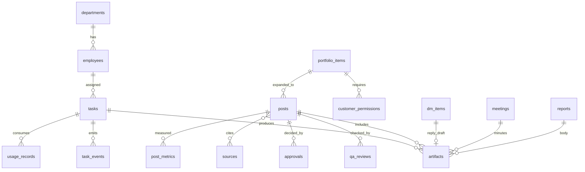

# 08. データモデル

SQLite + Drizzle ORM【D-02】。`task_events` と `audit_log` は append-only(UPDATE/DELETE禁止)。
`tasks.status` 等のスナップショット列はイベントからの導出キャッシュであり、再構築コマンドで復元可能。

## 1. ER図



## 2. テーブル定義

型表記: `pk`=TEXT主キー(ULID)、`ts`=ISO8601文字列、`json`=TEXT(JSON, Zod検証済み)。

### departments(部門)
| 列 | 型 | 備考 |
|---|---|---|
| id | pk | |
| name | text | 例: AIマーケティング部 |
| status | text | `active` / `planned`(準備中部門) |
| unlock_note | text? | 準備中部門の役割・解放条件表示用 |

### employees(AI社員)
| 列 | 型 | 備考 |
|---|---|---|
| id | pk | 例: `emp_aoi` |
| department_id | fk | |
| name / role | text | 名前・役職(表示用、設定で変更可) |
| agent_ref | text | `.claude/agents/` の定義名(実行層との対応) |
| model_profile | text | `light`/`standard`/`heavy`(→14) |
| persona_json | json | 性格・禁止事項(プロンプト生成元) |

### tasks(タスク)
| 列 | 型 | 備考 |
|---|---|---|
| id | pk | |
| idempotency_key | text unique | `type:subject:date`(冪等再実行) |
| type | text | research / plan_posts / write_copy / design / qa / report / dm_analyze / meeting … |
| title | text | UI表示用 |
| assignee_id | fk employees | |
| post_id | fk? posts | 投稿系タスクのみ |
| status | text | pending/queued/running/done/failed/cancelled/budget_paused(→06) |
| priority | int | |
| input_json | json | 入力参照(source ids, 素材path等) |
| retry_count | int | 上限2【確定】 |
| run_date | text | 所属run |
| error | text? | 失敗理由(隠さない) |
| created_at / started_at / finished_at | ts | |

### task_events(イベントログ・append-only・状態の正)
| 列 | 型 | 備考 |
|---|---|---|
| id | pk | |
| task_id | fk | |
| seq | int | タスク内連番 |
| ts | ts | |
| type | text | created/queued/started/heartbeat/stage_changed/artifact_added/succeeded/failed/cancelled/paused_budget/retried |
| payload_json | json | stage名・エラー等。**個人情報・秘密情報を含めない**【確定】 |
| actor | text | employee_id / `system` / `owner` |

### artifacts(成果物)
| 列 | 型 |備考 |
|---|---|---|
| id | pk | |
| task_id / post_id | fk / fk? | |
| kind | text | research_summary / post_plan / copy / carousel_spec / image / qa_report / minutes / report / reply_draft / export_bundle |
| version | int | 修正で+1(旧版保持) |
| content_json | json? | 構造化本体(スキーマ検証済み) |
| file_path | text? | 画像・書き出し等(data/workspace配下) |
| schema_version | text | Zodスキーマの版 |
| created_at | ts | |

### posts(投稿)
| 列 | 型 | 備考 |
|---|---|---|
| id | pk | |
| pillar | text | コンテンツの柱①〜⑥ |
| format | text | carousel / video_script / image / faq … |
| title | text | 管理用 |
| status | text | idea/drafting/qa_review/awaiting_approval/approved/rejected/revision_requested/exported/published/measured(→06) |
| planned_date | text? | カレンダー |
| caption_final | text? | 承認済みキャプション |
| hashtags_json | json? | |
| export_path | text? | 書き出し先 |
| published_at | ts? | 代表者が記録 |
| publish_method | text | `manual`(MVP固定)/ `api`(将来) |
| rights_state | text | `clear` / `blocked_rights` / `n/a` |

### post_sources(投稿⇔情報源 M:N) — post_id, source_id, cited_as

### sources(情報源)【§15確定項目を網羅】
| 列 | 型 | 備考 |
|---|---|---|
| id | pk | |
| title / url / publisher | text | 必須 |
| published_at / checked_at | ts | 必須(欠落レコードは投稿に引用不可) |
| is_primary | bool | 一次情報か |
| reliability | text | high/medium/low |
| summary | text | |
| fact_or_inference | text | `fact` / `inference`(推測と事実の分離) |

### qa_reviews — id, post_id, artifact_id?, result(`pass`/`fail`/`blocked_rights`), checklist_json(項目別判定), issues_json, reviewer_id, created_at

### approvals(承認)【§17監査対象】
| 列 | 型 | 備考 |
|---|---|---|
| id | pk | |
| subject_type / subject_id | text | post / reply_draft 等 |
| decision | text | approved / rejected / revision_requested |
| comment | text? | 修正指示・却下理由 |
| decided_by | text | `owner` 固定(MVP) |
| decided_at | ts | |

### portfolio_items(制作実績) — id, customer_name, site_url, assets_path, highlights_json(課題/工夫/技術/価値), permission_id fk, created_at

### customer_permissions(公開許可)【§17確定】
| 列 | 型 | 備考 |
|---|---|---|
| id | pk | |
| customer_name | text | |
| scope_json | json | name/url/screenshot/testimonial 別の可否 |
| status | text | `verbal_only` / `recorded` / `pending` / `denied` |
| evidence_path | text? | 同意DM・メールのスクショ等(07_customer-permissions/) |
| granted_at / expires_at | ts / ts? | |

### dm_items【第2段階 — スキーマ定義のみMVPで作成可、書き込み経路は実装しない】 — id, imported_at, masked_text(Q5確定: AI処理後NULL化=原文破棄), summary, category, lead_score, urgency, missing_questions_json, reply_draft_artifact_id, status(new/analyzed/replied/closed), replied_at ※保存されるのは要約・分類・対応状況のみ

### meetings — id, kind(weekly/monthly), held_on, agenda_json, decisions_json, minutes_artifact_id

### reports — id, kind(daily/weekly/monthly), period_start/period_end, body_artifact_id

### post_metrics(代表者入力の実績値) — id, post_id, measured_at, reach, profile_views, saves, shares, comments, dm_starts, follower_count, note ※未入力は未入力のまま(推測で埋めない)

### usage_records(利用量) — id, task_id, model_profile, est_input_chars, est_output_chars, wall_seconds, ts ※Maxプラン枠内でも記録し日報に表示(→14)。金額は「API利用時の参考換算」として表示

### audit_log(append-only)【§17確定】 — id, ts, actor, action(approve/reject/revise/publish_recorded/permission_recorded/task_cancel/task_resume/setting_changed/…), subject_type, subject_id, detail_json

### settings — key, value_json(投稿ペース、しきい値、通知設定、ブランドトークン参照等)

## 3. 状態導出(リデューサ)

```
employeeDisplayState(emp) =
  当該社員のactiveタスク(status∈{queued,running,budget_paused}) と
  最新イベント鮮度(heartbeat>10分で stale) から導出
  → idle / researching / meeting / creating / qa / awaiting_approval(担当成果物が承認待ち)
    / done_today / error / budget_paused / stale(状態不明)
```

- 導出ロジックは `src/core/reducers/` の純関数とし、単体テスト対象(→ `16`)
- `posts.status` 等スナップショットとイベントの不整合検出コマンド(`company doctor`)を用意し、不整合時はイベント側を正とする

## 4. バックアップ・復旧【§17確定】

- 日次: kickoff終了時に `data/company.db` を `data/backups/company-{date}.db` へコピー(直近14世代)+ workspace差分
- 週次: zip化し、代表者がGoogle Driveへ手動アップロード(将来Drive API化)【推奨RC-5】
- 復旧: `company restore --from {date}` でDB差し替え → `company doctor` で整合確認
